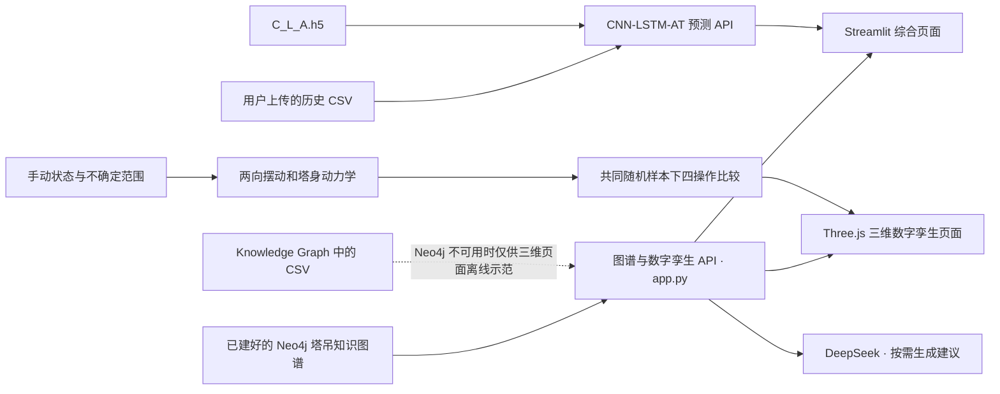

# 塔吊安全风险预测与推演系统

本项目面向**塔式起重机施工安全**。构建了知识图谱风险推演、历史数据预测和三维数字孪生平台，支持风险分析、运行回放及措施比较。

**使用说明、公式、不确定性、代价假设和试验验证格式见 [OPERATION_MODEL.md](OPERATION_MODEL.md)。** 


> **使用边界：**采用可编辑示范参数与简化动力学模型，概率是给定模型与不确定范围下的短时超限频率，结果用于研究演示和措施比较，提供决策参考。

## 使用入口

| 入口 | 地址 | 用来做什么 | 主要依赖 |
| --- | --- | --- | --- |
| 综合页面 | `http://localhost:8501` | 选择安全因素、施工阶段和指标，查看图谱风险、事故链；上传 CSV 使用 CNN-LSTM-AT 预测 | Streamlit、图谱 API；CSV 预测另需预测 API |
| 运行推演平台 | `http://localhost:8000/twin/` | 手动输入状态，播放 4–20 秒动力学推演，比较四种操作、超限概率和代价 | FastAPI、NumPy；无需 Neo4j/TensorFlow/大模型 |
| 原工序演示 | `http://localhost:8000/twin/legacy.html` | 顶升、附着安装、拆卸及静态工况的 60 秒示范 | 图谱 API；Neo4j 不可用时读取本地 CSV |
| API 文档 | `http://localhost:8000/docs` | 查看或调试图谱与数字孪生接口 | 图谱 API |

项目中有四条**相互独立的数据流程**：运行操作推演、知识图谱因素推演、原工序示范、CNN-LSTM-AT 历史 CSV 预测。



## 快速启动

以下命令在项目根目录运行，示例使用 PowerShell，推荐 Python 3.11 与独立虚拟环境。新版操作推演无需 Neo4j；在线图谱功能需连接包含相应数据的数据库。新用户须先导入 `Knowledge Graph/` 的 CSV；已有正确图谱时无需重复导入，项目不会自动创建或改写数据库。

### 1. 启动图谱与数字孪生 API（端口 8000）

```powershell
python -m pip install -r requirements-operations.txt
python -m uvicorn app:app --host 127.0.0.1 --port 8000
```

浏览器打开 `http://localhost:8000/twin/` 即可手动输入和比较措施。若 Python 环境已装好项目依赖，可直接启动，无需安装 TensorFlow。在线图谱按需在启动前配置：

```powershell
$env:NEO4J_URI = "bolt://127.0.0.1:7687"
$env:NEO4J_USER = "neo4j"
$env:NEO4J_PASSWORD = "你的 Neo4j 密码"
$env:NEO4J_DATABASE = "neo4j"
python -m uvicorn app:app --host 127.0.0.1 --port 8000
```

`http://localhost:8000/health/db` 可检查 Neo4j 连接。若 Neo4j 不可用，新版操作推演仍正常计算，并使用本地 CSV 解释知识链；原三维工序页面读取 CSV 进行离线示范。综合页面的图谱因素推演仍需要 Neo4j。

### 2. 启动综合页面（端口 8501）

在第二个终端运行：

```powershell
python -m pip install -r requirements.txt
python -m streamlit run streamlit_app.py
```

打开 `http://localhost:8501`。页面顶部有三维数字孪生入口。

### 3. 按需启动 CNN-LSTM-AT 预测 API（端口 8001）

只有使用“上传历史数据并预测”功能时才需要此服务。TensorFlow 依赖较大，建议使用单独的 Python 环境。在第三个终端运行：

```powershell
python -m pip install -r requirements-prediction.txt
python -m uvicorn prediction_api:app --host 127.0.0.1 --port 8001
```

### 4. 按需启用 AI 决策

推荐复制项目根目录的 `.env.example` 为 `.env`，在本机编辑并填写自己的密钥（已有 `.env` 时直接编辑，勿覆盖）：

```dotenv
DEEPSEEK_API_KEY=在本机填写自己的密钥
DEEPSEEK_MODEL=deepseek-flash
USE_LOCAL_LLM=false
```

后端从项目根目录读取此文件，与启动终端所在位置无关。也可以在**启动端口 8000 API 的同一个终端**，于启动前设置环境变量：

```powershell
$env:DEEPSEEK_API_KEY = "你的 DeepSeek API Key"
$env:DEEPSEEK_MODEL = "deepseek-flash"
```

`DEEPSEEK_MODEL` 可省略，默认是 `deepseek-flash`。进程环境变量优先于 `.env`；修改进程环境变量后需要重启端口 8000 API，修改 `.env` 中的 AI 配置则在下次请求时读取。若曾设置 `USE_LOCAL_LLM=true`，将其改为 `false` 才会调用 DeepSeek。不要将真实密钥发到聊天或提交到版本库，`.gitignore` 已排除 `.env`。


`GET http://localhost:8000/api/v1/infer/llm-status` 可查看后端是否读到密钥、SDK 是否安装及当前模型，不返回密钥，也不发送付费请求；“配置就绪”不代表已经验证网络、密钥有效性或余额。综合页面“分析与行动建议”内也提供“DeepSeek 配置与诊断”。

## 如何使用

### A. 知识图谱风险推演

在 `http://localhost:8501` 选择安全因素及其适用的施工阶段，再输入关联指标的现场观测值，点击“预测风险并推演”。页面会展示指标危险度、因素激活度、相关风险、事故链和知识图谱，也可以请求大模型管理建议。

图谱主要关系为：

| 图谱关系 | 用途 |
| --- | --- |
| `HAS_INDICATOR` | 因素关联哪些指标，以及权重、风险方向和阈值 |
| `ACTIVE_IN` | 因素适用的施工阶段及阶段系数 |
| `CAUSES` | 安全因素可能导致的风险 |
| `LEADS_TO` | 风险可能演化成的事故 |

系统读取 Neo4j 中的图谱；`Knowledge Graph/` 保存对应的 CSV 快照，新用户需先将其导入自己的数据库，项目不会自动导入或改写数据库。图谱推演通过指标阈值和权重计算情景风险，其概率值不是经过事故样本校准的频率。

### B. 手动运行推演与措施选择

在 `http://localhost:8000/twin/`：

1. 输入回转角及角速度、幅度、吊重、绳长、风速/方向、两向摆角与摆速，可选输入塔顶位移。设备参数、不确定范围、限值依据、障碍物、操作能力与代价均可自由编辑。
2. 点击“运行四种操作推演”。四种措施使用相同的初始状态样本、阵风与参数误差，每 0.02 秒检查超限；页面每 0.2 秒回放一次。可切换操作、拖动时间，查看吊物摆动、构件受力和轨迹范围。
3. 比较时段内联合超限概率与 95%计数区间、摆角/内力峰值 P95、配对风险变化、预计到达时间和停机代价。先筛选约束，再按风险预算与总代价选择；全部不满足预算或全部不可行时明确提示。
4. 查看风险原因、知识链和限值依据；按需生成 DeepSeek 定性解释。全部概率与量化建议由计算器产生。
5. 导出/重导入参数、导出完整 JSON 与时间曲线 CSV。上传独立试验的验证 CSV，可得到概率可靠性曲线、Brier/ECE 和 MAE/RMSE/区间覆盖率；无试验时不声称已校准。

可载入“前方障碍物”“已有摆动”“强阵风”“超额定工况”等可编辑演示。物理模型、统计口径、局限与 CSV 列名详见 [OPERATION_MODEL.md](OPERATION_MODEL.md)。

### B2. 原工序与静态工况示范

在 `http://localhost:8000/twin/legacy.html`：

1. 左侧输入**吊重、幅度、风速、回转角**，选择“正常吊装”“顶升”“安装附着”或“拆卸”。展开“设备示范参数”可以修改塔高、臂长、附着高度、刚度和额定值，然后点击“运行情景推演”。
2. 中间拖动三维塔吊旋转视角，使用滚轮缩放；点击构件可查看编号、作用力、弯矩和利用率。播放或拖动时间滑块可查看未来 60 秒的状态。
3. 右侧读取塔顶位移、关键弯矩、附着轴力和贝叶斯情景风险概率的时间曲线。
4. 下方比较“保持原方案”“减小吊重 25%”“缩小幅度 20%”三种情景的未来结果，按需点击“生成 AI 建议”。

三种视觉编码各有含义：**实体颜色表示结构利用率**，**右侧风险面板表示贝叶斯情景概率**，**半透明虚影表示未来位置**。虚影中的位移经过视觉放大，不能用画面比例读取真实位移。

默认示范设备为塔高 48 m、臂长 55 m、附着高度 18 m 和 36 m；默认吊重 5 t、幅度 35 m、风速 8 m/s、回转角 35°。模型每 5 秒输出一个点，共推演 60 秒；演示过程假设最高 12% 的阵风和 20° 的回转变化。塔顶位移等响应采用简化悬臂梁等效计算，风险由所选工序、超载、自由高度和风速等因素及图谱 `CAUSES` 关系通过 noisy-OR 合成。界面显示 I006、I014、I015、I016、I034 的输入或等效计算值，**不会回写 Neo4j**。

### C. 上传 CSV 进行 CNN-LSTM-AT 预测

在综合页面的“CNN-LSTM-AT 参数预测”面板上传历史 CSV。文件必须至少有 **20 行**，且包含数值列 `output`、`input1` 至 `input8`；`time` 可选。可选择 **1–100 步**预测并下载结果 CSV。预测服务使用项目中的 `C_L_A.h5` 和 `inputdata.csv`，只预测 `output`；多步预测时，未来的 `input1`–`input8` 沿用最后一行的值。

这些列目前仍是原有的通用名称，**尚未定义为塔吊专用监测指标，也没有新增塔吊训练数据**。`CNN-LSTM-AT-predict.py` 训练脚本保留，供后续更新指标和数据。当前预测实现还对模型反归一化后的 `output` 施加了 **1.2 倍后处理系数**（见 `prediction_service.py`）；在解释或重新训练模型前应检查这一设定。

## 主要文件

| 文件或目录 | 作用 |
| --- | --- |
| `app.py` | Neo4j 图谱推演、数字孪生、AI 决策及图谱查询 API；提供 `/twin/` 静态页面 |
| `digital_twin_service.py` | 60 秒情景、简化结构响应、构件利用率和 noisy-OR 风险计算 |
| `operation_models.py`、`operation_service.py` | 手动状态校验、两向摆动/塔身动力学、共同随机推演、直接超限概率和措施选择 |
| `operation_knowledge.json` | 四种措施的适用条件、目标风险与代价取舍，只读知识扩展 |
| `OPERATION_MODEL.md` | 新模型公式、限值来源、统计口径、使用说明和试验验证格式 |
| `digital_twin/` | Three.js 页面、交互脚本、样式及本地 Three.js 文件 |
| `streamlit_app.py` | 综合页面、图谱结果展示与 CSV 上传入口 |
| `inference_service.py`、`risk_scoring.py` | 图谱可视化、DeepSeek 决策和指标危险度计算 |
| `prediction_api.py`、`prediction_service.py` | 独立 CNN-LSTM-AT 预测服务 |
| `C_L_A.h5`、`inputdata.csv` | 当前预测模型与归一化参考数据 |
| `Knowledge Graph/` | 塔吊知识图谱的节点及关系 CSV；已建好的 Neo4j 才是在线查询来源 |

新版接口：`GET /api/v1/operations/defaults`、`POST /api/v1/operations/simulate`、`POST /api/v1/operations/validate`、`POST /api/v1/operations/advice`。原接口：`POST /api/v1/infer/safety`（图谱因素推演）、`POST /api/v1/twin/simulate`（原工序演示）、`POST /api/v1/infer/llm-decision`；独立预测服务提供 `POST http://localhost:8001/api/v1/predict`。具体字段可在 API 文档查看。

## 常见问题

| 现象 | 检查方式 |
| --- | --- |
| 因素列表为空、图谱推演失败 | 检查 Neo4j 是否启动，`NEO4J_*` 设置是否正确；访问 `/health/db`；确认节点标签、`id` 属性和关系已存在 |
| 三维页面显示“离线示范” | Neo4j 查询失败或缺少相关 `CAUSES` 关系；三维页面改用本地 CSV，页面顶部会显示数据来源 |
| 三维模型不显示 | 刷新页面并查看模型区域的错误提示；检查 `/twin/main.mjs` 和 `/twin/vendor/` 静态资源能否访问，浏览器需支持 WebGL |
| “生成 DeepSeek 解释”无法点击 | 更新代码后重启端口 8000 服务并强制刷新。新版修改参数后可直接点击，会自动更新推演；仅加载或请求期间暂时禁用 |
| AI 建议失败 | 检查 `/api/v1/infer/llm-status` 与页面具体报错；在根目录 `.env` 填写密钥，检查网络、模型及账户余额；进程环境变量优先 |
| CSV 预测无法连接 | 确认端口 8001 的独立预测服务已启动、`C_L_A.h5` 存在，上传 CSV 符合列名和行数要求 |

开发者可以运行 `python -m unittest -v test_operations.py test_operation_api.py test_digital_twin.py test_llm_decision.py` 检查模型、操作比较、验证指标与 API。项目内的 Three.js 0.180.0 文件使用其随包附带的 MIT 许可，见 `digital_twin/vendor/package/LICENSE`。
